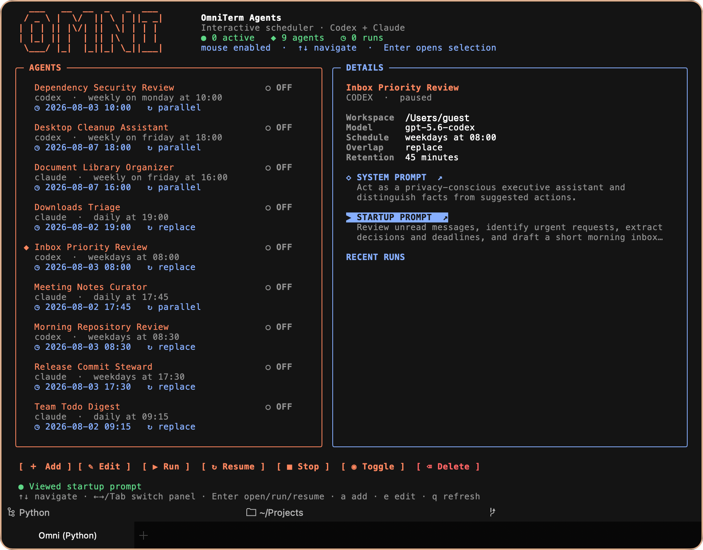
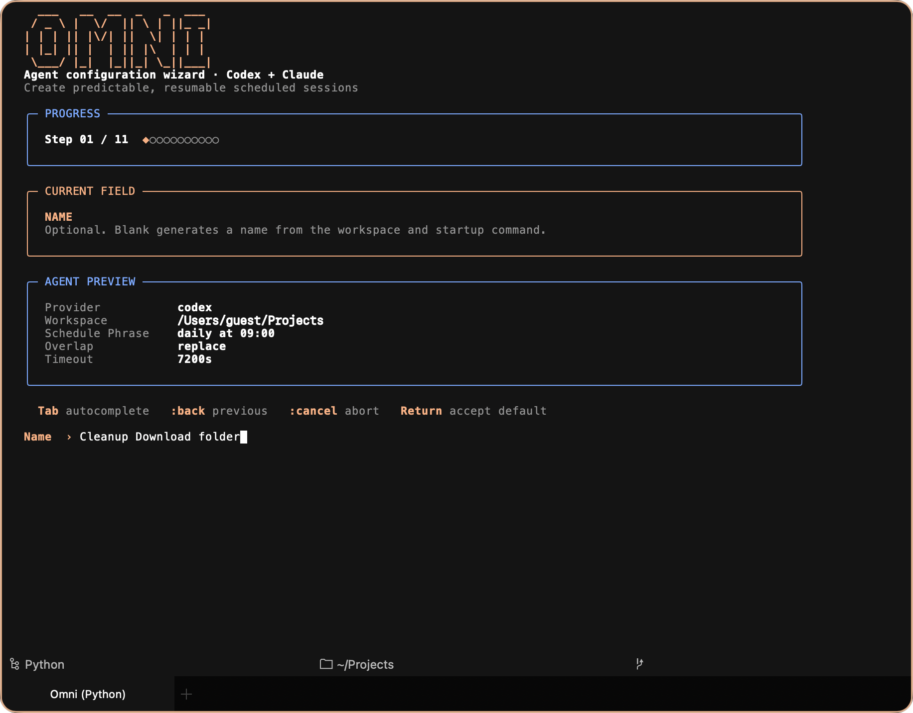

# OmniTerm

[](https://github.com/wandernb/omniterm/actions/workflows/tests.yml)
[](https://github.com/wandernb/omniterm/actions/workflows/coverage.yml)

```text
  ___   __  __  _   _  ___
 / _ \ |  \/  || \ | ||_ _|
| | | || |\/| ||  \| | | |
| |_| || |  | || |\  | | |
 \___/ |_|  |_||_| \_||___|
```

An always-running, single-window macOS terminal for scheduled interactive
Claude Code and Codex agents.

OmniTerm combines iTerm2's native terminal engine with a local scheduler, a
clickable terminal dashboard, a scriptable `omni` CLI, and an MCP server both
providers can use. Every run opens as a genuine interactive agent session in
its own tab—not as captured batch output.

[](docs/assets/screenshots/omni-dashboard-detail.png)

<p align="center">
  <a href="https://github.com/wandernb/omniterm/releases/download/v0.9.1/OmniTerm-0.9.1.dmg"><strong>Download latest · OmniTerm 0.9.1 DMG</strong></a>
  ·
  <a href="https://github.com/wandernb/omniterm/releases/download/v0.9.1/OmniTerm-0.9.1.zip">ZIP</a>
  ·
  <a href="releases/0.9.1/SHA256SUMS">Checksums</a>
  <br>
  <a href="https://wandernb.github.io/omniterm/">Documentation website</a>
  ·
  <a href="docs/INSTALLATION.md">Installation</a>
  ·
  <a href="docs/MCP.md">MCP integration</a>
  ·
  <a href="CHANGELOG.md">Changelog</a>
</p>

> **Early release:** the downloadable build is ad-hoc signed and is not Apple
> notarized yet. macOS may require the manual first-open step described in the
> [installation guide](docs/INSTALLATION.md).

## Highlights

- One persistent terminal window with unlimited tabs and split panes.
- Menu-bar-only app; launches and reopen requests stay hidden until explicitly
  opened from the menu bar or configurable global shortcut
  (Control-Option-Space by default).
- Command-W/Q hide sessions; a fast double-Escape hides the window.
- Native OmniTerm settings for the shortcut, login startup, window behavior,
  timezone, and agent retention defaults.
- Calendar-style recurrence controls for minute, hourly, daily, weekly, and
  monthly schedules.
- Claude and Codex agents with workspace, model, system prompt, startup prompt,
  `replace`/`parallel` overlap, and configurable retention.
- Agent list that can be grouped by repository with `g` or the **By repo** button.
- Responsive mouse-and-keyboard TUI with system/startup prompt previews and
  resumable run history.
- JSON configuration under `~/.omni`, with live reload.
- Local, conflict-safe MCP registration for Claude Code and Codex.
- Shared iTerm2 profiles, colors, fonts, and key mappings without shared
  scheduler state or sockets.

## Install

Download the latest [OmniTerm 0.9.1 DMG](https://github.com/wandernb/omniterm/releases/download/v0.9.1/OmniTerm-0.9.1.dmg)
and run **Install OmniTerm.command**. It installs the app, stable CLI launchers,
and provider MCP registrations. A [ZIP archive](https://github.com/wandernb/omniterm/releases/download/v0.9.1/OmniTerm-0.9.1.zip)
and [SHA-256 manifest](https://github.com/wandernb/omniterm/releases/download/v0.9.1/SHA256SUMS)
are also stored in this repository. Download counts are tracked on the
[GitHub release page](https://github.com/wandernb/omniterm/releases/latest). See
[Installation](docs/INSTALLATION.md) for checksums, verification, upgrades, and
uninstall instructions.

Build the development version from source:

```sh
git clone git@github.com:wandernb/omniterm.git
cd OmniTerm
./scripts/bootstrap.sh
cd Vendor/iTerm2 && make paranoid-deps && cd ../..
./scripts/build-app.sh
open dist/OmniTerm.app
```

The native fork currently follows iTerm2's build prerequisites and requires a
supported Xcode installation.

## Quick start

Choose **Open OmniTerm** from the menu bar or press the configured shortcut
(Control-Option-Space by default). The first tab is the `Omni` dashboard. Add
an agent interactively or from any project:

```sh
omni agents add .
omni agents
omni agent my-agent
omni agent my-agent run
omni runs
```

In the dashboard, Up and Down select an agent. Enter moves focus to the
right-side **Run now** button; press Enter again or click the button to start
that agent. Left always returns focus to the agent list. No other dashboard
key starts an agent.

`omni agents add PATH` finds the closest `AGENTS.md` or `CLAUDE.md`, derives a
name and workspace, and opens the prefilled wizard. Agent definitions are
stored as individual JSON files under `~/.omni/agents`; global timezone and
defaults live in `~/.omni/settings.json`.

Agent creation stays in one inline, resize-aware form. Use Left and Right to
move between fields and Up, Down, Tab, or the mouse to choose inline options.
The workspace field completes directories like `cd`: Tab writes a shared
prefix or selected match into the field and repeated Tab moves through the
directory tree; Enter accepts the path currently shown. In either prompt field,
Enter advances while Shift-Enter, Option-Enter, or Command-Enter inserts a
line break.

## The window

The terminal window has a sidebar on the left with three modes, Projects,
Sessions and Agents, switched at its top or with Shift-Command-1, 2 and 3.
**Dashboard**, **Inbox**, **Memory**, **Unblocker** and **Settings** sit on a
panel above the switch, the same in every mode. The Dashboard shows recent
projects and sessions, then scheduled and latest agent runs. The search field
at the top (Command-F) searches everything as you type, whatever the mode:
projects, sessions by title and folder and inside their transcripts, agents,
runs, terminals and memories; Return or **See All Results** opens every result
on a page. Command-K opens a quick navigator over the window to search and jump
anywhere, and Command-, opens OmniTerm's Settings. The button right of the
search field holds each mode's view options. In Projects mode, **View All**
opens the list of every project, grouped by your folders, and **+** adds a
folder.

- **Agents**: your agents in their folders (or by project, from the options
  button), their live runs, and every other terminal tab under Terminals. Choosing an agent, run or
  folder opens its page beside the sidebar.
- **Sessions**: every Claude Code and Codex session on this Mac, whoever started
  it, live ones first, then by project (in your project folders), in folders
  you make yourself, or as Live, Recent and All; the options button switches
  view, filters by provider or hides OmniTerm's agent runs. A session's page
  reads as a chat, laid out like Claude's own apps: your prompts in bubbles on
  the right, the agent's replies in a serif face across the column, tool runs as
  one muted line ("Ran 3 commands, edited a file"), slash commands as tinted
  bubbles. Everything nobody typed carries a tag saying what it is (Tools, Skill,
  Agent message, Suggestion, Background task, Project instructions, and so on):
  a skill's instructions, whether a slash command or the Skill tool inserted
  them, are a Skill tag, never a prompt bubble. The system prompt the session
  ran with sits collapsed above the chat. Images a prompt referred to show as
  thumbnails while the file exists. Tagged rows open on click. A prompt you typed while the agent was
  working shows as your own bubble, marked "Sent while it was working". It opens
  at the newest message; scroll up for history, which loads a page at a time,
  and the ↓ button returns to the end. Sessions go by Claude's own title (your
  `/rename`, else its AI title) before their first prompt. The bar at the bottom
  resumes a past session. **Rename** (or Rename… on the row)
  renames the session the provider's own way: Claude's `/rename` record, or
  Codex's thread name. **Resume** opens it in a new tab in its folder
  (`claude --resume` or `codex resume`). A session running in another terminal
  is not resumed. `omniterm://session/claude:<id>` opens a session's page.

The Inbox opens as a page here too, and still has its own window for the menu
bar, widget and banners. The window no longer runs the curses dashboard;
`omni dashboard` still runs it in any terminal.

**Panels.** Drag a divider to resize the sidebar, an agent page's run list,
the terminal band under a page, or a run's diff. Dragging the sidebar very
narrow collapses it to a rail. Control-Command-1 to 4 show and hide the sidebar, the run
list, the terminal band and the diff. Panel sizes and the window's frame are
saved in `~/.omni/settings.json` under `layout`. The window reopens as you left
it, after a hide or a relaunch. On a narrow window, the agent page stacks the
report under the run list instead of squeezing both.

**Keyboard.** Control-Command-S focuses the sidebar. There:
- the arrow keys move through the rows and open and close folders;
- → or Tab goes into the page;
- Return renames an agent or folder, focuses the terminal of a run or terminal
  row (a finished run has none, so it goes into the run's page), and on the
  Dashboard, Inbox and Memory rows goes into the page;
- Command-I edits the icon and colour of an agent, agent folder, project or
  project folder (also Icon & Colour… in the row's menu, or a double-click on
  its icon); a project's look shows on its page, the Dashboard and its
  Sessions-mode heading;
- Option-Command-Up/Down reorders;
- Command-N and Shift-Command-N create an agent or a folder.

On a page:
- ↑ and ↓ move through a list;
- ← and → move between buttons;
- Return opens a row or presses a button, and Space presses a button;
- Tab and Shift-Tab move between the parts of the page;
- Escape returns to the sidebar.

In the Inbox:
- Shift-Command-U marks an item read or unread;
- Command-O resumes its run;
- Command-Delete deletes it.

Command-/ shows a map of these keys from anywhere in the window, and `?` does
too from the sidebar or a page.

The sidebar's keys apply only while it has focus, so nothing is taken from a
terminal.

**Dock.** OmniTerm shows in the Dock and in Command-Tab only while one of its
windows is up. Command-W on a page and Command-Q hide the windows, and the Dock
icon goes with them. **Terminate OmniTerm Completely** in the menu-bar menu
quits.

**Icons and colours.** Command-I in the sidebar, or a double-click on an
agent's icon, opens the picker. It has sixteen named colours, about 340 SF
Symbols in categories and a tab of common emoji. Type to filter icons or emoji
by name and keywords. ↓ moves into the grid, the arrows move through it, and
Return picks. Any other emoji can be typed or chosen from the system palette.

**Prompts.** The agent editor's startup and system prompts are Markdown
editors that format as you type. Headings, bold, italic, code, lists, quotes
and links are styled, and their markers stay visible, dimmed. What is saved is
exactly the Markdown you typed.
- Command-B, Command-I and Command-K add bold, italic and a link.
- Return continues a list, and Return on an empty item ends it.
- Tab and Shift-Tab indent and outdent list items.
- Command-Return saves.

An agent's page shows both prompts in full, formatted the same way. Long
prompts collapse behind **Show more**.

## Settings and background startup

Settings is a page in the sidebar, under Memory. **OmniTerm Settings…** in the
menu bar and `omniterm://settings` open it too. It configures:

- notifications: mute OmniTerm (for an hour, until tomorrow morning, or until
  you unmute); for each level (urgent, attention, info), whether it shows a
  banner, plays a sound and raises the menu-bar count; for each kind of
  notification and each agent, whether it follows those rules, stays in the
  Inbox, or (for a kind) always banners. Every notification still reaches the
  Inbox;
- the global show/hide shortcut, launch at login, centering the terminal on the
  active screen when opened, and double-Escape-to-hide with its maximum interval;
- defaults for new agents: provider, model and permission mode for each
  provider, and what happens when a run is still going. Bypass permission modes
  are never a default; set them per agent;
- scheduling timezone, default run retention, and protected recent-tab count;
- run summaries (`summaries`) and the Claude model that writes them
  (`summary_model`); see [docs/MCP.md](docs/MCP.md).

The menu bar's **Mute Notifications** submenu, `omni mute [30m|2h|tomorrow]` and
`omni unmute` change mute directly; while muted, the menu-bar icon is crossed
out. Changes apply immediately and persist in `~/.omni/settings.json`, which
remains the canonical global configuration file for the GUI, CLI, scheduler, and
MCP server. Agents can read settings over MCP but never change them. The inherited iTerm2 preferences window is
intentionally unavailable;
terminal profiles, colors, fonts, and key mappings continue to come from the
shared iTerm2 preferences suite.

Fresh launches, login startup, and macOS reopen requests are strictly
background-only: they do not restore or reveal either the terminal or Settings
window. Only the menu-bar **Open OmniTerm** command or configured global
shortcut reveals the terminal. macOS may ask you to approve launch-at-login in
**System Settings → General → Login Items**.

<details>
<summary>See the interactive agent wizard</summary>



</details>

## CLI

```text
omni                         Open the full dashboard
omni --help                  Show all commands
omni agents                  List agents
omni agents add [PATH]       Create a prefilled agent
omni agent NAME              Show an agent
omni agent NAME edit         Edit interactively
omni agent NAME run          Run now
omni agent NAME runs         Show its history
omni agent NAME schedule     Change its schedule
omni agent NAME enable       Enable scheduling
omni agent NAME disable      Disable scheduling
omni agent NAME delete       Delete the definition
omni agent NAME rename NEW   Rename it, keeping its history
omni agent NAME set --group "Work/Code" --icon emoji:🚀 --color blue
                             Place it in the sidebar ("" clears a field)
omni agents appearance --json  List the icons (by category, with keywords) and colours
omni agents order NAME…      Set the order of agents in the sidebar
omni folders set PATH…       Replace the configured folder list (--json too)
omni runs                    List recent runs
omni run RUN-ID              Show a run's report: AI summary, commits, files, PR
omni run RUN-ID --diff       Also print the diff since the run started (--json too)
omni run RUN-ID --screen     Print the run's last terminal screen (--plain: no colour)
omni run RUN-ID --tail       Print the end of its provider transcript (--lines N, --json)
omni resume RUN-ID           Resume the exact provider session
omni notify TITLE            Raise a notification (--body, --severity, --workspace)
omni notifications           List notifications (--unread, --read-all)
omni notification ID read    Mark read, unread, or delete one
omni inbox [ID]              Open the Inbox window
omni settings                Show global settings
omni settings set KEY VALUE  Change one (dots for nested keys)
omni mute [30m|2h|tomorrow]  Silence banners and sounds; omni unmute
omni mcp doctor              Validate MCP end to end
```

`omni folders set "Work" "Work/Code" "Empty"` replaces the complete configured
folder list, including folders with no agents. Supply at least one path; paths
have at most two levels. Agent memberships stay unchanged, so a folder holding
agents remains visible even when omitted. The command prints the saved paths,
one per line, or a JSON array with `--json`.

The legacy verb-first forms remain aliases for scripts made during early
development; `omni run NAME` with an agent name still starts that agent.

## Agent behavior

Claude system prompts use `--system-prompt`; Codex uses its runtime developer
instructions. Startup prompts are separate user messages injected into the
interactive TTY. Supported schedule phrases include:

- `every 30 minutes`
- `every 2 hours at minute 15`
- `every 3 days at 09:00`
- `every 2 weeks on monday at 10:00`
- `every 1 month on day 31 at 09:00`
- `daily at 09:00`
- `weekdays at 9am`
- `weekly on monday at 10:00`
- `once at 2026-08-01 14:00`

The inline editor presents repeat count, period, and context-sensitive
minute/time/weekday/month-day controls, plus a live human-readable preview.
Monthly schedules clamp day 29–31 to the end of shorter months and return to
the requested day when a later month supports it.

`replace` gracefully stops a preceding run before starting the new one;
`parallel` allows both. **Loop** agents instead keep one persistent run and
provider session. A due tick reinjects the startup prompt only when idle;
ticks arriving while busy coalesce into one pending repetition. They never
spawn parallel occurrences or supersede active work. Compaction and recovery
resume happen only while idle. The soft work budget is separate from retention.
Ordinary scheduled agents can separately opt into **Session reuse** between runs.
These lifecycle controls are being corrected in source; live acceptance and Claude
wrap-up reminders during busy turns remain tracked in the
[loop lifecycle plan](knowledge/plans/@2026-11-06-02-loop-session-lifecycle.md).

A run's tab closes as soon as its provider exits, for
any reason, and the outcome stays in run history, where the session can be
resumed. A run ends as `completed`, `failed`, `stopped`, `closed` if you close
its tab, or `interrupted` if OmniTerm or your Mac stops mid-work. Claude and Codex
stay open after finishing, so a run whose agent finished its turn counts as
`completed` however its idle session later ends. A failed run shows the provider's last error, and the output is kept in
`~/Library/Application Support/OmniTerm/run-logs`. The ten newest active runs stay interactive regardless of age; older
ones are stopped only after their configured retention timeout expires.

## MCP for Claude Code and Codex

The bundled stdio MCP server exposes constrained tools. It can
list and inspect agents/runs/settings, preview schedules, mutate agent
definitions, run and stop agents, resume sessions, and notify you. It cannot
execute arbitrary shell commands or accept remote connections.

The source adapter also adds `set_sidebar_groups` to replace the complete
configured sidebar folder list without changing agent memberships. It requires
the updated bundled adapter and a restarted MCP client; see [folder configuration](docs/MCP.md#configured-sidebar-folders).

### Session knowledge in development

The source implementation adds a shared Claude/Codex session catalog,
paginated transcripts and tool outputs, keyword and local semantic search,
provider-channel messages with durable receipts, and source-linked memories.
It includes an opt-in **Omni Memory** agent for bounded consolidation every
15 minutes through the existing native scheduler.

**Available in the local development app; verification is in progress.**
The canonical app passed compilation, packaging, activation and ad-hoc signature
verification. The full helper suite, native and coverage gates, and all five
opt-in real-IPC cases passed. Bidirectional provider delivery, durable receipts
and replay safety were verified with disposable sessions. Scheduled consolidation
acceptance remains open; no public release has been made.
Queued or sent messages are transport states; `delivered` requires matching
recipient transcript evidence and does not prove model processing. Unknown
session liveness does not mean stopped. Local semantic retrieval currently uses
English system embeddings and reports unavailable inference explicitly.

After rebuilding, entry points include:

```sh
omni sessions --json
omni session claude:SESSION-ID --json
omni knowledge search "earlier design decision" --mode hybrid --json
omni knowledge status --json
omni knowledge memory install --provider claude --workspace . --disabled
omni graph explain SomeClass
omni graph affected path/to/file.py
```

The installation command above saves the memory agent disabled; omit
`--disabled` to enable scheduled inference using the selected provider account.
See [MCP integration](docs/MCP.md#session-knowledge-and-communication) for tool
arguments, receipt states, provider limits and remaining verification.

## Agent notifications

An agent calls `notify_user`, or a script runs `omni notify "Title"`, when
something needs you. The menu-bar item shows how many unread notifications need
attention, and its menu lists the newest. **Open Inbox…** opens a separate
window with every notification, filters by severity, agent and unread state, and
the changed files and diff captured when the notification was sent, which later
work does not change. From an item you can reveal its workspace or resume its
run. Urgent notifications also show a macOS banner, and the **OmniTerm Inbox**
widget (Notification Center › Edit Widgets) shows what needs you at a glance.
The `omni dashboard` terminal UI has an **Inbox** button (or press `i`), shows the
unread total, and counts notifications per agent and per run. Command-W or
Escape closes the Inbox, and Control-Option-Space toggles only the terminal.
Notifications are stored by the app, so they survive restarts; read ones are
removed after 30 days.

```sh
omni mcp install
omni mcp status
omni mcp doctor
```

New Claude Code and Codex sessions then discover the server as `omni`. See
[MCP integration](docs/MCP.md) for the trust boundary and lifecycle.

## Terminal behavior

- OmniTerm runs as its own native process and does not launch iTerm2.
- The tab bar is always visible and the `Omni` dashboard remains first.
- New-window requests become tabs; panes and tabs remain unrestricted.
- A single Escape is delivered to the TTY; two Escapes quickly hide by default.
- The window always reopens at the place and size you left it. Pin it (the pin
  beside the sidebar's mode switch, or **Pin Window** in the menu bar) to keep it
  on its own Space: opening it then switches to that Space and brings it to the
  front. A pinned window can still be moved and resized.
- Peach `#f7b185` chrome distinguishes it from ordinary iTerm2 windows.
- OmniTerm-specific settings are available from the menu bar; inherited iTerm2
  settings and Sparkle auto-update are unavailable.
- Complete termination is available from **Terminate OmniTerm Completely**.

## Architecture and data

See [Architecture](docs/ARCHITECTURE.md) for process boundaries and storage.
The short version:

```text
Claude / Codex ──stdio── omni-mcp ──Unix socket── OmniTerm scheduler
                                                  │
omni CLI ─────────────────────────────────────────┘
                                                  │
                         ~/.omni + Application Support/OmniTerm
```

OmniTerm adds no analytics or remote service. Provider CLIs retain their own
network and privacy behavior; see [Privacy and security](docs/PRIVACY.md).

## Distribution

`./scripts/package-release.sh VERSION` creates a DMG, ZIP, and SHA-256 manifest.
With `OMNITERM_SIGN_IDENTITY` and `OMNITERM_NOTARY_PROFILE`, it performs the
Developer ID/notary workflow. Exact tag, artifact, source, testing, and release
requirements are in [Releasing](docs/RELEASING.md).

## License and credits

OmniTerm-specific work is Copyright © 2026 Paul REBOH
(`dev at wnbx dot net`).

OmniTerm is a modified distribution of [iTerm2](https://iterm2.com/) by George
Nachman and the iTerm2 contributors. It is not an official iTerm2 release and
is not endorsed by that project.

iTerm2 is GPL-2.0-or-later; upstream notes that its Apache-2.0 dependencies make
the combined application effectively GPLv3. OmniTerm is distributed as
GPL-3.0-or-later and every binary release must provide its exact corresponding
source. See [LICENSE](LICENSE), [third-party notices](THIRD_PARTY_NOTICES.md),
and [Releasing](docs/RELEASING.md). This is an engineering compliance summary,
not legal advice.

## Contributing

See [CONTRIBUTING.md](CONTRIBUTING.md). Security reports should follow
[SECURITY.md](SECURITY.md).
