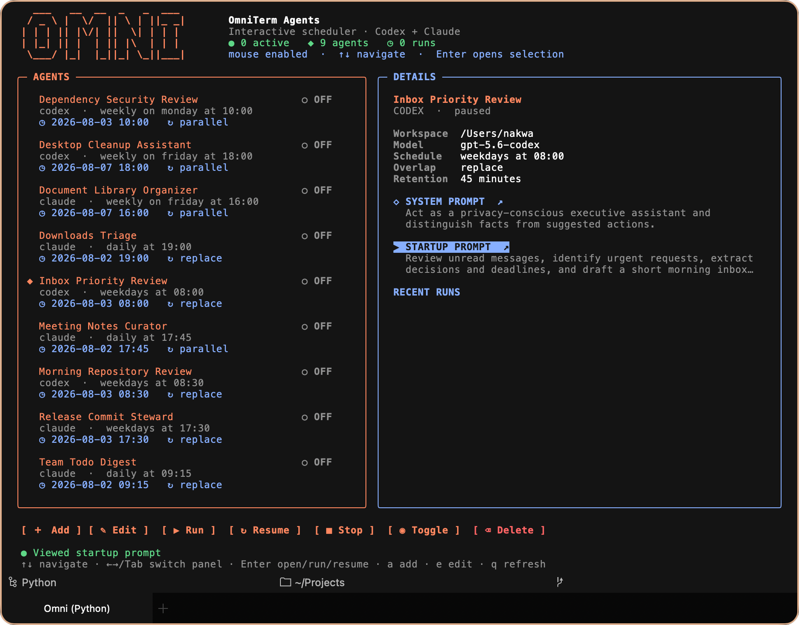
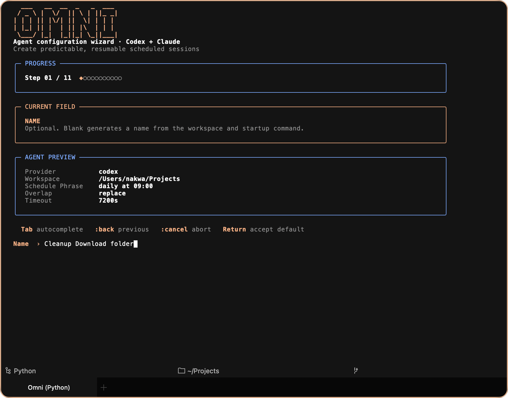

# OmniTerm

[](https://github.com/wandernb/omniterm/actions/workflows/tests.yml)
[](https://github.com/wandernb/omniterm/actions/workflows/coverage.yml)

```text
  ___   __  __  _   _  ___
 / _ \ |  \/  || \ | ||_ _|
| | | || |\/| ||  \| | | |
| |_| || |  | || |\  | | |
 \___/ |_|  |_||_| \_||___|
```

An always-running, single-window macOS terminal for scheduled interactive
Claude Code and Codex agents.

OmniTerm combines iTerm2's native terminal engine with a local scheduler, a
clickable terminal dashboard, a scriptable `omni` CLI, and an MCP server both
providers can use. Every run opens as a genuine interactive agent session in
its own tab—not as captured batch output.

[](docs/assets/screenshots/omni-dashboard-detail.png)

<p align="center">
  <a href="https://github.com/wandernb/omniterm/releases/download/v0.3.1/OmniTerm-0.3.1.dmg"><strong>Download latest · OmniTerm 0.3.1 DMG</strong></a>
  ·
  <a href="https://github.com/wandernb/omniterm/releases/download/v0.3.1/OmniTerm-0.3.1.zip">ZIP</a>
  ·
  <a href="releases/0.3.1/SHA256SUMS">Checksums</a>
  <br>
  <a href="https://wandernb.github.io/omniterm/">Documentation website</a>
  ·
  <a href="docs/INSTALLATION.md">Installation</a>
  ·
  <a href="docs/MCP.md">MCP integration</a>
  ·
  <a href="CHANGELOG.md">Changelog</a>
</p>

> **Early release:** the downloadable build is ad-hoc signed and is not Apple
> notarized yet. macOS may require the manual first-open step described in the
> [installation guide](docs/INSTALLATION.md).

## Highlights

- One persistent terminal window with unlimited tabs and split panes.
- Menu-bar-only app; launches and reopen requests stay hidden until explicitly
  opened from the menu bar or configurable global shortcut
  (Control-Option-Space by default).
- Command-W/Q hide sessions; a fast double-Escape hides the window.
- Native OmniTerm settings for the shortcut, login startup, window behavior,
  timezone, and agent retention defaults.
- Calendar-style recurrence controls for minute, hourly, daily, weekly, and
  monthly schedules.
- Claude and Codex agents with workspace, model, system prompt, startup prompt,
  `replace`/`parallel` overlap, and configurable retention.
- Agent list that can be grouped by repository with `g` or the **By repo** button.
- Responsive mouse-and-keyboard TUI with system/startup prompt previews and
  resumable run history.
- JSON configuration under `~/.omni`, with live reload.
- Local, conflict-safe MCP registration for Claude Code and Codex.
- Shared iTerm2 profiles, colors, fonts, and key mappings without shared
  scheduler state or sockets.

## Install

Download the latest [OmniTerm 0.3.1 DMG](https://github.com/wandernb/omniterm/releases/download/v0.3.1/OmniTerm-0.3.1.dmg)
and run **Install OmniTerm.command**. It installs the app, stable CLI launchers,
and provider MCP registrations. A [ZIP archive](https://github.com/wandernb/omniterm/releases/download/v0.3.1/OmniTerm-0.3.1.zip)
and [SHA-256 manifest](https://github.com/wandernb/omniterm/releases/download/v0.3.1/SHA256SUMS)
are also stored in this repository. Download counts are tracked on the
[GitHub release page](https://github.com/wandernb/omniterm/releases/latest). See
[Installation](docs/INSTALLATION.md) for checksums, verification, upgrades, and
uninstall instructions.

Build the development version from source:

```sh
git clone git@github.com:wandernb/omniterm.git
cd OmniTerm
./scripts/bootstrap.sh
cd Vendor/iTerm2 && make paranoid-deps && cd ../..
./scripts/build-app.sh
open dist/OmniTerm.app
```

The native fork currently follows iTerm2's build prerequisites and requires a
supported Xcode installation.

## Quick start

Choose **Open OmniTerm** from the menu bar or press the configured shortcut
(Control-Option-Space by default). The first tab is the `Omni` dashboard. Add
an agent interactively or from any project:

```sh
omni agents add .
omni agents
omni agent my-agent
omni agent my-agent run
omni runs
```

In the dashboard, Up and Down select an agent. Enter moves focus to the
right-side **Run now** button; press Enter again or click the button to start
that agent. Left always returns focus to the agent list. No other dashboard
key starts an agent.

`omni agents add PATH` finds the closest `AGENTS.md` or `CLAUDE.md`, derives a
name and workspace, and opens the prefilled wizard. Agent definitions are
stored as individual JSON files under `~/.omni/agents`; global timezone and
defaults live in `~/.omni/settings.json`.

Agent creation stays in one inline, resize-aware form. Use Left and Right to
move between fields and Up, Down, Tab, or the mouse to choose inline options.
The workspace field completes directories like `cd`: Tab writes a shared
prefix or selected match into the field and repeated Tab moves through the
directory tree; Enter accepts the path currently shown. In either prompt field,
Enter advances while Shift-Enter, Option-Enter, or Command-Enter inserts a
line break.

## Settings and background startup

Choose **OmniTerm Settings…** from the menu bar to configure:

- the global show/hide shortcut;
- launch at login;
- centering the terminal on the active screen when opened;
- double-Escape-to-hide and its maximum interval;
- scheduling timezone, default run retention, and protected recent-tab count.

Changes apply immediately and persist in `~/.omni/settings.json`, which remains
the canonical global configuration file for the GUI, CLI, scheduler, and MCP
server. The inherited iTerm2 preferences window is intentionally unavailable;
terminal profiles, colors, fonts, and key mappings continue to come from the
shared iTerm2 preferences suite.

Fresh launches, login startup, and macOS reopen requests are strictly
background-only: they do not restore or reveal either the terminal or Settings
window. Only the menu-bar **Open OmniTerm** command or configured global
shortcut reveals the terminal. macOS may ask you to approve launch-at-login in
**System Settings → General → Login Items**.

<details>
<summary>See the interactive agent wizard</summary>



</details>

## CLI

```text
omni                         Open the full dashboard
omni --help                  Show all commands
omni agents                  List agents
omni agents add [PATH]       Create a prefilled agent
omni agent NAME              Show an agent
omni agent NAME edit         Edit interactively
omni agent NAME run          Run now
omni agent NAME runs         Show its history
omni agent NAME schedule     Change its schedule
omni agent NAME enable       Enable scheduling
omni agent NAME disable      Disable scheduling
omni agent NAME delete       Delete the definition
omni runs                    List recent runs
omni resume RUN-ID           Resume the exact provider session
omni settings                Show global settings
omni mcp doctor              Validate MCP end to end
```

The legacy verb-first forms remain aliases for scripts made during early
development.

## Agent behavior

Claude system prompts use `--system-prompt`; Codex uses its runtime developer
instructions. Startup prompts are separate user messages injected into the
interactive TTY. Supported schedule phrases include:

- `every 30 minutes`
- `every 2 hours at minute 15`
- `every 3 days at 09:00`
- `every 2 weeks on monday at 10:00`
- `every 1 month on day 31 at 09:00`
- `daily at 09:00`
- `weekdays at 9am`
- `weekly on monday at 10:00`
- `once at 2026-08-01 14:00`

The inline editor presents repeat count, period, and context-sensitive
minute/time/weekday/month-day controls, plus a live human-readable preview.
Monthly schedules clamp day 29–31 to the end of shorter months and return to
the requested day when a later month supports it.

`replace` gracefully stops a preceding run before starting the new one;
`parallel` allows both. A run's tab closes as soon as its provider exits, for
any reason, and the outcome stays in run history, where the session can be
resumed. A run ends as `completed`, `failed`, `stopped`, or `closed` if you close
its tab. A failed run shows the provider's last error, and the output is kept in
`~/Library/Application Support/OmniTerm/run-logs`. The ten newest active runs stay interactive regardless of age; older
ones are stopped only after their configured retention timeout expires.

## MCP for Claude Code and Codex

The bundled stdio MCP server exposes twelve constrained scheduler tools. It can
list and inspect agents/runs/settings, preview schedules, mutate agent
definitions, run and stop agents, and resume sessions. It cannot execute
arbitrary shell commands or accept remote connections.

```sh
omni mcp install
omni mcp status
omni mcp doctor
```

New Claude Code and Codex sessions then discover the server as `omni`. See
[MCP integration](docs/MCP.md) for the trust boundary and lifecycle.

## Terminal behavior

- OmniTerm runs as its own native process and does not launch iTerm2.
- The tab bar is always visible and the `Omni` dashboard remains first.
- New-window requests become tabs; panes and tabs remain unrestricted.
- A single Escape is delivered to the TTY; two Escapes quickly hide by default.
- The window opens centered on the current screen and Space by default.
- Peach `#f7b185` chrome distinguishes it from ordinary iTerm2 windows.
- OmniTerm-specific settings are available from the menu bar; inherited iTerm2
  settings and Sparkle auto-update are unavailable.
- Complete termination is available from **Terminate OmniTerm Completely**.

## Architecture and data

See [Architecture](docs/ARCHITECTURE.md) for process boundaries and storage.
The short version:

```text
Claude / Codex ──stdio── omni-mcp ──Unix socket── OmniTerm scheduler
                                                  │
omni CLI ─────────────────────────────────────────┘
                                                  │
                         ~/.omni + Application Support/OmniTerm
```

OmniTerm adds no analytics or remote service. Provider CLIs retain their own
network and privacy behavior; see [Privacy and security](docs/PRIVACY.md).

## Distribution

`./scripts/package-release.sh VERSION` creates a DMG, ZIP, and SHA-256 manifest.
With `OMNITERM_SIGN_IDENTITY` and `OMNITERM_NOTARY_PROFILE`, it performs the
Developer ID/notary workflow. Exact tag, artifact, source, testing, and release
requirements are in [Releasing](docs/RELEASING.md).

## License and credits

OmniTerm-specific work is Copyright © 2026 Paul REBOH
(`dev at reboh dot net`).

OmniTerm is a modified distribution of [iTerm2](https://iterm2.com/) by George
Nachman and the iTerm2 contributors. It is not an official iTerm2 release and
is not endorsed by that project.

iTerm2 is GPL-2.0-or-later; upstream notes that its Apache-2.0 dependencies make
the combined application effectively GPLv3. OmniTerm is distributed as
GPL-3.0-or-later and every binary release must provide its exact corresponding
source. See [LICENSE](LICENSE), [third-party notices](THIRD_PARTY_NOTICES.md),
and [Releasing](docs/RELEASING.md). This is an engineering compliance summary,
not legal advice.

## Contributing

See [CONTRIBUTING.md](CONTRIBUTING.md). Security reports should follow
[SECURITY.md](SECURITY.md).
