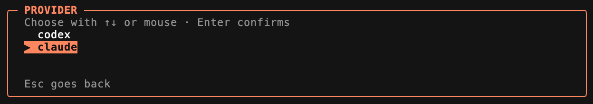

# OmniTerm

```text
  ___   __  __  _   _  ___
 / _ \ |  \/  || \ | ||_ _|
| | | || |\/| ||  \| | | |
| |_| || |  | || |\  | | |
 \___/ |_|  |_||_| \_||___|
```

An always-running, single-window macOS terminal for scheduled interactive
Claude Code and Codex agents.

OmniTerm combines iTerm2's native terminal engine with a local scheduler, a
clickable terminal dashboard, a scriptable `omni` CLI, and an MCP server both
providers can use. Every run opens as a genuine interactive agent session in
its own tab—not as captured batch output.

[](docs/assets/screenshots/omni-dashboard-detail.png)

<p align="center">
  <a href="https://somelibs.github.io/omniterm/">Documentation website</a>
  ·
  <a href="docs/INSTALLATION.md">Installation</a>
  ·
  <a href="docs/MCP.md">MCP integration</a>
</p>

> **Pre-release:** packaging and original OmniTerm artwork are implemented.
> Public binaries still require a Developer ID signing identity and Apple
> notarization credentials.

## Highlights

- One persistent terminal window with unlimited tabs and split panes.
- Menu-bar-only app; it launches hidden and toggles with Control-Option-Space.
- Command-W/Q hide sessions; a fast double-Escape hides the window.
- Human schedules such as `weekdays at 9am` and `every 30 minutes`.
- Claude and Codex agents with workspace, model, system prompt, startup prompt,
  `replace`/`parallel` overlap, and configurable retention.
- Responsive mouse-and-keyboard TUI with system/startup prompt previews and
  resumable run history.
- JSON configuration under `~/.omni`, with live reload.
- Local, conflict-safe MCP registration for Claude Code and Codex.
- Shared iTerm2 profiles, colors, fonts, and key mappings without shared
  scheduler state or sockets.

## Install

For a release, download the DMG and run **Install OmniTerm.command**. It installs
the app, stable CLI launchers, and provider MCP registrations. See
[Installation](docs/INSTALLATION.md) for checksums, verification, upgrades, and
uninstall instructions.

Build the development version from source:

```sh
git clone git@github.com:somelibs/omniterm.git
cd OmniTerm
./scripts/bootstrap.sh
cd Vendor/iTerm2 && make paranoid-deps && cd ../..
./scripts/build-app.sh
open dist/OmniTerm.app
```

The native fork currently follows iTerm2's build prerequisites and requires a
supported Xcode installation.

## Quick start

Press Control-Option-Space to open OmniTerm. The first tab is the `Omni`
dashboard. Add an agent interactively or from any project:

```sh
omni agents add .
omni agents
omni agent my-agent
omni agent my-agent run
omni runs
```

`omni agents add PATH` finds the closest `AGENTS.md` or `CLAUDE.md`, derives a
name and workspace, and opens the prefilled wizard. Agent definitions are
stored as individual JSON files under `~/.omni/agents`; global timezone and
defaults live in `~/.omni/settings.json`.

<details>
<summary>See the interactive agent wizard</summary>




</details>

## CLI

```text
omni                         Open the full dashboard
omni --help                  Show all commands
omni agents                  List agents
omni agents add [PATH]       Create a prefilled agent
omni agent NAME              Show an agent
omni agent NAME edit         Edit interactively
omni agent NAME run          Run now
omni agent NAME runs         Show its history
omni agent NAME schedule     Change its schedule
omni agent NAME enable       Enable scheduling
omni agent NAME disable      Disable scheduling
omni agent NAME delete       Delete the definition
omni runs                    List recent runs
omni resume RUN-ID           Resume the exact provider session
omni settings                Edit global settings
omni mcp doctor              Validate MCP end to end
```

The legacy verb-first forms remain aliases for scripts made during early
development.

## Agent behavior

Claude system prompts use `--system-prompt`; Codex uses its runtime developer
instructions. Startup prompts are separate user messages injected into the
interactive TTY. Supported schedule phrases include:

- `every 30 minutes`
- `daily at 09:00`
- `weekdays at 9am`
- `weekly on monday at 10:00`
- `once at 2026-08-01 14:00`

`replace` gracefully stops a preceding run before starting the new one;
`parallel` allows both. The ten newest run tabs remain interactive regardless
of age. Older tabs are eligible for eviction only after their configured
retention timeout expires.

## MCP for Claude Code and Codex

The bundled stdio MCP server exposes twelve constrained scheduler tools. It can
list and inspect agents/runs/settings, preview schedules, mutate agent
definitions, run and stop agents, and resume sessions. It cannot execute
arbitrary shell commands or accept remote connections.

```sh
omni mcp install
omni mcp status
omni mcp doctor
```

New Claude Code and Codex sessions then discover the server as `omni`. See
[MCP integration](docs/MCP.md) for the trust boundary and lifecycle.

## Terminal behavior

- OmniTerm runs as its own native process and does not launch iTerm2.
- The tab bar is always visible and the `Omni` dashboard remains first.
- New-window requests become tabs; panes and tabs remain unrestricted.
- A single Escape is delivered to the TTY; two Escapes within 350 ms hide.
- The window opens centered on the current screen and Space.
- Peach `#f7b185` chrome distinguishes it from ordinary iTerm2 windows.
- Settings and Sparkle auto-update are disabled in OmniTerm.
- Complete termination is available from **Terminate OmniTerm Completely**.

## Architecture and data

See [Architecture](docs/ARCHITECTURE.md) for process boundaries and storage.
The short version:

```text
Claude / Codex ──stdio── omni-mcp ──Unix socket── OmniTerm scheduler
                                                  │
omni CLI ─────────────────────────────────────────┘
                                                  │
                         ~/.omni + Application Support/OmniTerm
```

OmniTerm adds no analytics or remote service. Provider CLIs retain their own
network and privacy behavior; see [Privacy and security](docs/PRIVACY.md).

## Distribution

`./scripts/package-release.sh VERSION` creates a DMG, ZIP, and SHA-256 manifest.
With `OMNITERM_SIGN_IDENTITY` and `OMNITERM_NOTARY_PROFILE`, it performs the
Developer ID/notary workflow. Exact tag, artifact, source, testing, and release
requirements are in [Releasing](docs/RELEASING.md).

## License and credits

OmniTerm-specific work is Copyright © 2026 Paul REBOH
(`dev at reboh dot net`).

OmniTerm is a modified distribution of [iTerm2](https://iterm2.com/) by George
Nachman and the iTerm2 contributors. It is not an official iTerm2 release and
is not endorsed by that project.

iTerm2 is GPL-2.0-or-later; upstream notes that its Apache-2.0 dependencies make
the combined application effectively GPLv3. OmniTerm is distributed as
GPL-3.0-or-later and every binary release must provide its exact corresponding
source. See [LICENSE](LICENSE), [third-party notices](THIRD_PARTY_NOTICES.md),
and [Releasing](docs/RELEASING.md). This is an engineering compliance summary,
not legal advice.

## Contributing

See [CONTRIBUTING.md](CONTRIBUTING.md). Security reports should follow
[SECURITY.md](SECURITY.md).
